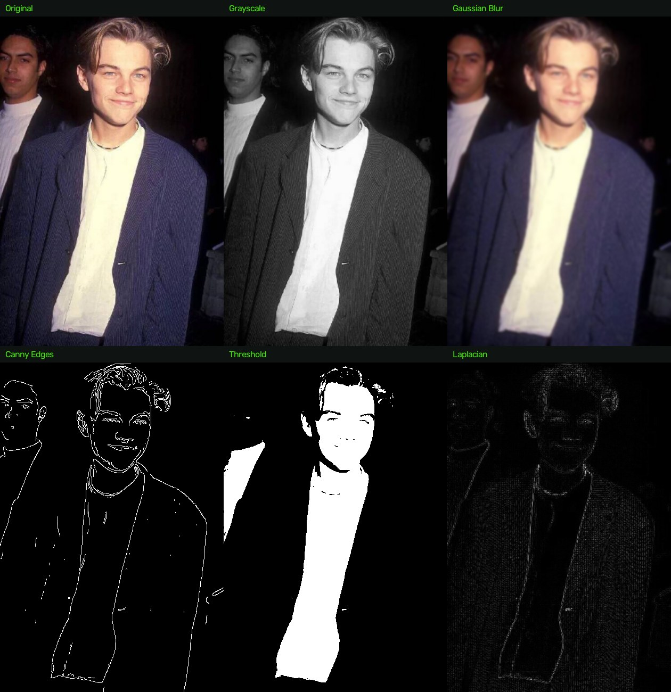
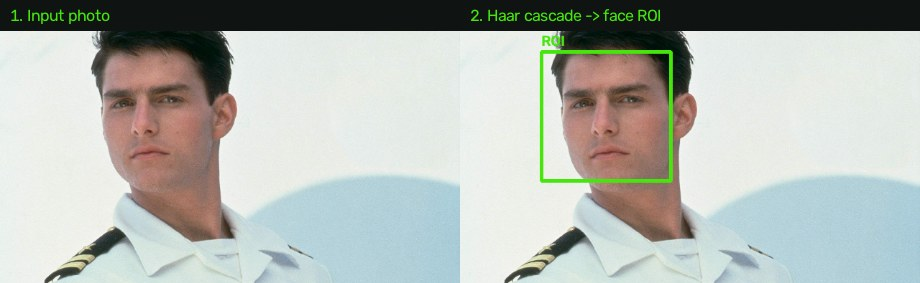
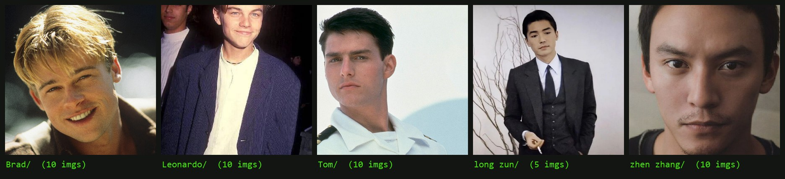

[English](README.md) | [简体中文](README.zh-CN.md)

<a id="opencv-learning-exercises--vision-effects--face-recognition--opencv-学习练习视觉效果与人脸识别"></a>
<a id="opencv-learning-exercises--vision-effects--face-recognition"></a>
<a id="opencv-学习练习视觉效果与人脸识别"></a>

# OpenCV Learning Exercises — Vision Effects & Face Recognition

> **What this is:** my personal **learning exercises** for OpenCV's vision module and face-recognition
> module — a study repository, **not a production project**. I'm keeping it public as a record of how
> these fundamentals feed into my later work (YOLO pedestrian detection for the
> [Networked Cities workshop](https://github.com/Shawn200212/DigitalFutures-Workshop-Pedestrian-Activity-Prediction),
> and local TripoSR deployment via PyTorch).

The code is organized as **two modules**:

<a id="module-1--vision-display-effects-16-progressive-scripts--模块-1--视觉显示效果16-个渐进脚本"></a>
<a id="module-1--vision-display-effects-16-progressive-scripts"></a>
<a id="模块-1--视觉显示效果16-个渐进脚本"></a>

## Module 1 · Vision display effects (16 progressive scripts)



*Six of the operators covered, run on one training photo: grayscale conversion, Gaussian blur,
Canny edge detection, binary thresholding and the Laplacian gradient.*

| File | Topic |
| --- | --- |
| `ReadImages.py` / `ReadVideos.py` | Reading images & video streams |
| `rescale.py` | Resizing and frame rescaling |
| `draw.py` | Drawing shapes and text |
| `transformations.py` | Translation, rotation, flipping |
| `contours.py` | Contour detection |
| `Spaces.py` / `split_merge.py` | Color spaces, channel split & merge |
| `smoothing.py` / `bitwise.py` / `masking.py` | Blurring, bitwise ops, masking |
| `histogram.py` / `thresh.py` / `gradients.py` | Histograms, thresholding, edge gradients |
| `basic.py` / `test.py` | Basics & scratch tests |

<a id="module-2--face-recognition-training-face_recognitionpy-and-friends--模块-2--人脸识别训练"></a>
<a id="module-2--face-recognition-training-face_recognitionpy-and-friends"></a>
<a id="模块-2--人脸识别训练"></a>

## Module 2 · Face recognition training (`face_recognition.py` and friends)



*Step 1 of the pipeline: the Haar cascade locates the face and crops the ROI that gets fed to
the LBPH recognizer.*

### Training set



```
Photo/Train/<person>/*.jpg          five celebrity folders, photos crawled from the web
   → haar_face.xml                  Haar cascade detects face ROIs      (face_detect.py)
   → grayscale ROIs + labels        collected per person                (Faces_train.py)
   → cv.face.LBPHFaceRecognizer     trained & persisted
   → face_trained.yml + features.npy + labels.npy
   → prediction with confidence     label + box drawn on the image      (face_recognition.py)
```

| File | Role |
| --- | --- |
| `face_detect.py` | Haar-cascade face detection on a single image |
| `Faces_train.py` | Build the training set from `Photo/Train/` and train the LBPH recognizer |
| `face_recognition.py` | Load the trained model and recognize faces with confidence scores |
| `haar_face.xml` | OpenCV frontal-face Haar cascade |

**About the training data** — `Photo/Train/` holds photos of five celebrities (Brad / Leonardo /
Tom / long zun / zhen zhang) crawled from the internet, used **only as an analysis source for this
coding exercise**. The photo set and the trained artifacts (`face_trained.yml`, `features.npy`,
`labels.npy`) are not distributed with the repo — point `Faces_train.py` at your own
`Photo/Train/<person>/` folders to reproduce.

<a id="run--运行"></a>
<a id="run"></a>
<a id="运行"></a>

## Run

```bash
pip install opencv-contrib-python numpy
python Faces_train.py       # after preparing Photo/Train/<person>/
python face_recognition.py
```

---

🎨 **Portfolio — [ruixiaozhang.com](https://ruixiaozhang.com)** · game design, realtime animation, embodied AI and urban research
🎬 **YouTube — [project videos](https://www.youtube.com/channel/UCyr-ubod7eNa6XhET25vdmw)**
